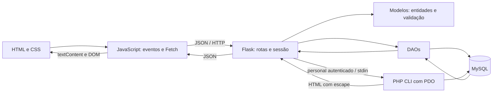

# EvoFit — arquitetura do sistema

**Autora:** Livia Nunes Coelho

**Disciplinas:** DWS, POO e Banco de Dados

## Camadas e responsabilidades

A aplicação principal utiliza Python/Flask com POO e DAOs, integrada ao front-end HTML/CSS/JavaScript por Fetch, conforme a orientação do Projeto Integrado.

| Camada | Arquivos | Responsabilidade |
| --- | --- | --- |
| Apresentação | `index.html`, `pages/`, `css/` | Estrutura semântica, formulários, navegação e layout responsivo |
| Cliente HTTP | `js/api.js`, `js/app.js` | Eventos, serialização JSON, Fetch e atualização do DOM |
| Controle | `app.py` | Rotas, sessão, autorização, códigos HTTP e respostas JSON |
| Domínio | `models.py` | Entidades e validação de atributos e prescrições |
| Acesso a dados | `dao.py` | DAOs, conexão MySQL, parâmetros e transações |
| Persistência | `banco/schema.sql` | Tabelas, relacionamentos, chaves, índices e restrições |
| Relatório complementar | `php_academico/relatorio.php` | Consulta MySQL com PDO e geração de HTML |

## Operações e persistência

GET consulta informações. POST cadastra entidades ou registra a conclusão; PUT atualiza; DELETE solicita exclusão. A validação acontece tanto na interface quanto no servidor. Cada DAO delimita os dados consultados ou alterados pelo perfil e pelo vínculo de equipe.

A gravação de um treino e sua lista de exercícios é atômica. Uma falha de integridade provoca rollback. A conclusão bloqueia a ficha durante a transação, verifica a versão da prescrição e aplica uma chave única de idempotência. O banco armazena registros de conclusão em UTC e os relaciona ao proprietário por meio do treino.

## Autenticação e acesso

A sessão Flask identifica o usuário. A aplicação carrega o perfil do banco e aplica o comportamento `pode_prescrever()` das entidades. As consultas de personal são limitadas aos alunos vinculados; o aluno consulta somente seus treinos e seu histórico. O ranking contém nomes e totais da equipe, sem expor e-mails ou hashes.

Os cookies de sessão usam HttpOnly e SameSite. O servidor rejeita mutações de origem incompatível e mantém credenciais fora do repositório. As rotas de arquivos públicos permitem somente páginas e recursos autorizados; código Python, PHP privado e arquivos de configuração não são publicados por essas rotas.

## Relatório PHP

A rota `/relatorio-php` autentica o personal e passa seu identificador ao processo PHP por stdin. O PHP utiliza PDO e parâmetros SQL para consultar a mesma base MySQL. O resultado é HTML com escape dos textos do banco. Não há uma segunda autenticação ou um endpoint PHP público.

## Interface de demonstração

A pasta `apresentacao/` reúne login, consulta e conclusão de treinos, histórico e ranking em uma página. Utiliza as mesmas rotas, regras e tabelas da aplicação principal. Os cadastros ficam nas páginas completas.

## Histórico de implementação

A edição PHP anterior permanece em `static/`, `php/`, `database/` e `legacy/`, com esquema separado. Sua documentação operacional está em [EDICAO_PHP_ORIGINAL.md](EDICAO_PHP_ORIGINAL.md). O fluxo considerado nesta arquitetura e na entrega integrada é o da aplicação Flask.
