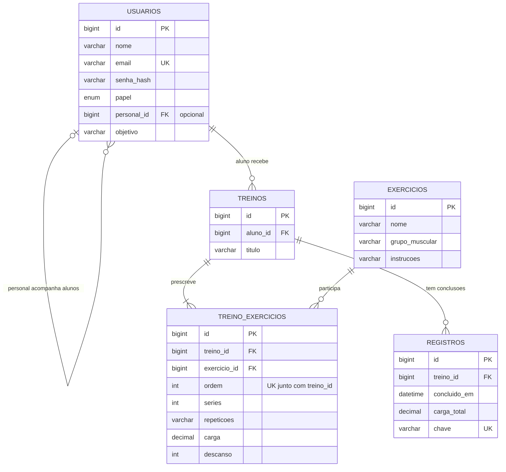
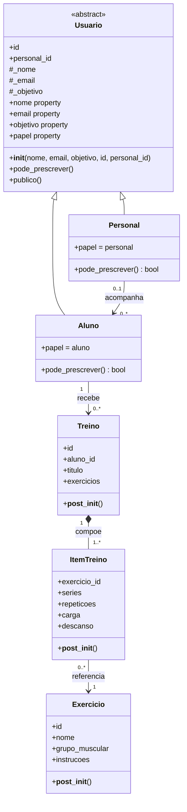
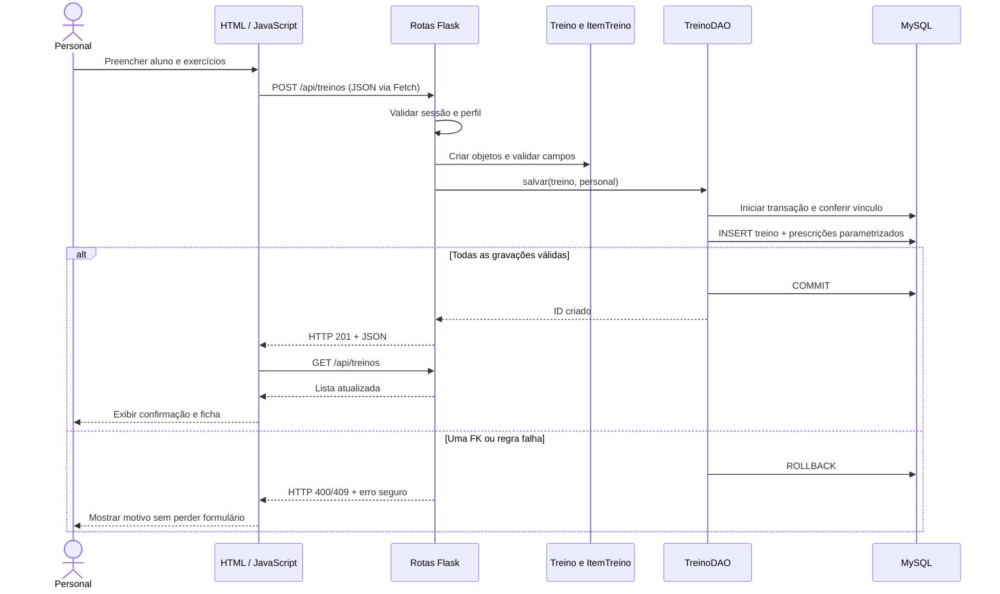

# EvoFit — Relatório de Modelagem de Dados e Orientação a Objetos

**Autora:** Livia Nunes Coelho

**Projeto Integrado:** Desenvolvimento de Websites (DWS), Programação Orientada a Objetos (POO) e Banco de Dados (BD)

**Data:** 16 de novembro de 2026

## Objetivo e fundamentação

O EvoFit é um sistema de acompanhamento de treinos que integra cadastro de alunos, catálogo de exercícios, prescrição de fichas, registro de conclusões e classificação da equipe. Este relatório apresenta a modelagem relacional, a estrutura de classes e as decisões de integridade da implementação em Python/Flask e MySQL.

A fundamentação utiliza os conteúdos das apostilas das disciplinas: modelagem entidade-relacionamento, normalização, consultas SQL, encapsulamento, herança, polimorfismo, composição, UML e persistência por DAO. O atendimento aos critérios do Projeto Integrado está relacionado às evidências em [REQUISITOS_AVALIACAO.md](REQUISITOS_AVALIACAO.md).

O banco acadêmico utiliza MySQL 8.0.16+ ou MariaDB 10.4+, com InnoDB e `utf8mb4`. Os scripts contêm `SET NAMES utf8mb4`, preservando os acentos na conexão com o cliente SQL. O esquema acadêmico possui armazenamento separado de outras instalações do sistema.

## Entidades e cardinalidades

Um personal pode acompanhar zero ou muitos alunos. Um aluno possui zero ou um personal: a possibilidade de conta independente está prevista no modelo. O catálogo de exercícios é compartilhado. Um treino pertence a um aluno e contém uma ou mais prescrições; o mesmo exercício pode aparecer em vários treinos. A aplicação rejeita exercício duplicado na mesma ficha. Um treino pode ter zero ou muitas conclusões, em dias diferentes.

No banco, a FK permite um treino temporariamente sem itens durante a transação. O DAO valida a lista, grava treino e itens em uma mesma transação e só confirma o conjunto completo. O mínimo de um item é uma regra do domínio, não uma garantia isolada da FK.

## Dicionário de dados e decisões

| Tabela | Responsabilidade | Chaves e regras principais |
| --- | --- | --- |
| `usuarios` | Identidade de personal e aluno, vínculo de equipe e objetivo | PK `id`; e-mail único; `personal_id` opcional referencia a própria tabela. Senhas só aparecem como hash. |
| `exercicios` | Nome, grupo muscular e instruções do catálogo | PK `id`; não guarda séries ou carga de uma prescrição individual. |
| `treinos` | Título de uma ficha atribuída a um aluno | PK `id`; FK `aluno_id → usuarios.id`. |
| `treino_exercicios` | Associação N:N e parâmetros prescritos | PK `id`; duas FKs; ordem única por treino; `DECIMAL(8,2)` para carga; descanso em segundos. |
| `registros` | Evento de conclusão de uma ficha | PK `id`; FK `treino_id`; data `DATETIME` em UTC; soma das cargas em `DECIMAL(10,2)`; chave única de idempotência. |

`registros` não repete `aluno_id`: o dono é obtido por `registros → treinos → usuarios`, evitando uma dependência transitiva. Depois de uma conclusão, o aluno do treino não pode mudar. O DAO rejeita essa troca; assim, o histórico não muda de proprietário.

`carga_total` é uma medida capturada no evento: soma das cargas informadas ao concluir os exercícios. Não é volume de treinamento (séries × repetições × carga), nem comparação clínica de desempenho. Alterar a prescrição mais tarde não recalcula o evento passado. O histórico implementado conserva a data, a ficha e a soma das cargas. O detalhamento histórico de cada exercício está fora desse modelo; o catálogo e a prescrição representam o estado atual.

As datas são armazenadas em UTC. A apresentação em horário local pertence à interface. A consulta mensal do arquivo SQL considera os limites do mês em UTC, mantendo o mesmo referencial temporal do armazenamento.

## Normalização: 1FN, 2FN e 3FN

**1FN:** cada célula contém um valor do seu atributo. A lista de exercícios não fica em JSON, texto separado por vírgulas ou colunas `exercicio1/exercicio2`. Cada prescrição ocupa uma linha em `treino_exercicios`.

**2FN:** os atributos dependem da chave completa. Na associação, a ordem é exclusiva dentro do treino, e séries, repetições, carga e descanso descrevem aquela prescrição. O nome do exercício fica no catálogo; o nome do aluno fica em `usuarios`.

**3FN:** atributos não chave não são repetidos por dependências transitivas. A ficha não copia nome ou e-mail do aluno; a prescrição não copia nome ou grupo do exercício; o registro não copia `aluno_id`. A soma histórica da carga é um atributo do evento, pois captura valores executados naquela conclusão, e não a soma mutável da prescrição atual.

Uma alteração de e-mail ocorre em uma linha; o treino passa a exibir o novo e-mail ao fazer JOIN. Isso evita anomalias de atualização. O evento histórico de conclusão permanece.

## Integridade e autorização

- FKs impedem referências a IDs inexistentes. `NOT NULL`, `UNIQUE` e `CHECK` complementam a validação da aplicação.
- Excluir um treino sem histórico remove seus itens por `ON DELETE CASCADE`. Um treino com conclusões é protegido por `ON DELETE RESTRICT`.
- Um exercício prescrito não pode ser removido; primeiro é preciso revisar as fichas que o usam. Um aluno com treinos também não pode ser apagado diretamente.
- `ENUM` limita os papéis, mas uma FK não verifica que `personal_id` aponta para um personal ou que `aluno_id` aponta para um aluno. Essas regras são verificadas pelo domínio/DAO. A consulta 14 audita essa coerência.
- O ID do personal vem da sessão autenticada. O DAO inclui esse vínculo nos filtros; um ID enviado pelo navegador não concede acesso a outra equipe.
- A chave única da conclusão evita duplicação de um mesmo envio. Repetir uma requisição com a mesma chave deve devolver o evento existente, sem criar outra pontuação.
- SQL usa parâmetros, nunca concatenação de conteúdo recebido. Erros apresentados ao usuário não expõem credenciais nem detalhes internos da conexão.

## Diagrama de classes e implementação Python

O diagrama representa entidades de `models.py`. Os DAOs em `dao.py` fazem a persistência; as rotas de `app.py` recebem HTTP, validam sessão e devolvem JSON. O frontend chama essas rotas com Fetch.

`Usuario` é abstrata e representa os atributos e comportamentos comuns aos papéis do sistema. `Personal` e `Aluno` herdam atributos e validações. O mesmo método `pode_prescrever()` responde de formas diferentes nas subclasses: polimorfismo aplicado à autorização. As propriedades validam nome, e-mail e objetivo antes de trocar o estado interno: encapsulamento. `Treino` contém objetos `ItemTreino`: composição. A entidade não executa SQL.

## Organização dos scripts e dados de demonstração

| Artefato | Finalidade e relação com o modelo |
| --- | --- |
| `banco/schema.sql` | Define as tabelas, chaves, índices e restrições do esquema relacional. A inicialização Python aplica esse esquema e cria as contas demonstrativas com hashes de senha. |
| `banco/dados_teste.sql` | Complementa o conjunto inicial com um exercício sem prescrição, um treino sem conclusão e quatro eventos fictícios de conclusão. As chaves `fixture-avaliacao-1` a `fixture-avaliacao-4` identificam os eventos destinados à análise da paginação. A repetição do script preserva os exemplos existentes. |
| `banco/consultas_avaliacao.sql` | Reúne 14 consultas comentadas com JOINs, subqueries, ordenação, paginação e auditoria de papéis. A variável `@personal_id` seleciona o personal demonstrativo no cliente SQL; nas rotas da aplicação, o identificador é obtido da sessão autenticada. |

Os casos sem correspondência permitem observar a diferença entre INNER JOIN e LEFT JOIN. A associação entre usuários, treinos, prescrições e exercícios permite analisar um JOIN de quatro tabelas. As subqueries escalares retornam medidas agregadas e preservam empates nas comparações com MAX/MIN. As consultas de paginação utilizam tamanho 2 e ordenação com desempate por identificador.

A consulta 14 verifica os papéis nos vínculos do domínio. Um resultado vazio indica ausência das inconsistências pesquisadas. Os totais e os valores agregados dependem do estado do banco: cadastros e conclusões posteriores alteram os resultados.

## Evidência de execução das consultas

Em 16/11/2026, schema, dados e as 14 consultas foram executados sem erro em MySQL 8.4 real. Depois do seed e dos complementos, o estado conferido foi: 3 usuários, 6 exercícios, 3 treinos, 4 prescrições e 6 conclusões. As quatro conclusões extras são dados fictícios identificados por chaves `fixture-avaliacao-*`, não execuções reais de atletas. Repetir o script preservou as contagens e as quatro chaves.

O LEFT JOIN preservou o aluno iniciante com zero treinos; dois exercícios ficaram sem prescrição e duas fichas sem conclusão. A média das seis cargas foi aproximadamente 35,33 kg; acima da média apareceram 36, 37 e 38 kg; MAX retornou 38 kg e MIN retornou 32 kg. As páginas 1 e 2, tamanho 2, trouxeram duas conclusões diferentes cada uma, sem sobreposição. A auditoria de papéis retornou zero linhas. A conexão UTF-8 preservou os acentos. Os resultados correspondem ao estado inicial registrado na validação e podem mudar com o uso posterior da aplicação.

## Conceitos analisados nas consultas e na implementação

| Conceito | Aplicação no EvoFit |
| --- | --- |
| Chave primária e chave estrangeira | `treinos.id` identifica a ficha; `treinos.aluno_id` referencia `usuarios.id`. |
| Entidade associativa | A relação N:N entre treino e exercício é resolvida por `treino_exercicios`, que contém os parâmetros da prescrição. |
| LEFT JOIN | Preserva alunos sem treino e exercícios sem ficha. `COUNT(t.id)` contabiliza apenas os pares existentes, sem contar o NULL da ausência de correspondência. |
| JOIN com múltiplas tabelas | A consulta 3 relaciona usuários, treinos, prescrições e exercícios por suas respectivas PKs e FKs. |
| Subquery escalar | AVG, MAX e MIN retornam um valor agregado para comparação com as conclusões da equipe. |
| Subquery de conjunto e existência | IN verifica pertencimento ao conjunto de alunos com conclusões; EXISTS verifica a existência de um registro relacionado sem multiplicar a ficha. |
| Cálculo de deslocamento | `OFFSET = (pagina - 1) × tamanho`. Com tamanho 2, as páginas 1, 2 e 3 utilizam os deslocamentos 0, 2 e 4. |
| Ordenação estável | O identificador desempata registros com a mesma data, evitando ambiguidade na sequência das páginas. |
| Integridade referencial e regras de papel | A FK garante a existência do usuário; a validação do DAO e a auditoria SQL verificam sua função de aluno ou personal no relacionamento. |
| Dependência transitiva | O registro de conclusão obtém o aluno por meio do treino, evitando repetir `aluno_id`. |
| Registro histórico | A soma das cargas conserva o valor do evento de conclusão, mesmo após a edição da prescrição. |

## Sequência: prescrever treino

Na conclusão, o servidor confere também o hash `versao` da prescrição recebida. Uma ficha alterada desde a consulta gera HTTP 409, sem criar registro; o aluno deve atualizar a página. A chave UUID já concluída continua idempotente mesmo que a ficha mude depois.

## Referências didáticas

- **COMECE AQUI! (PROJETO).** Projeto Integrado — DWS + POO + BD. Etapas de entrega e instruções de submissão. Turmas 2º TI-A, 2º TI-B, 2º TI-C e 2º TI-D. 2026, p. 1–2.
- **Apostila de Banco de Dados — ER Completa.** Entidades, atributos, relacionamentos, cardinalidades e participação.
- **Apostila de Banco de Dados — 2º bimestre.** Modelos de dados, normalização, relacionamentos e comandos SQL. 2026.
- **Apostila de Banco de Dados — 4º bimestre.** Preparação para o projeto AV2 e rubrica de avaliação. Prof. Samuel Elias. 2026, p. 30 e 38.
- **Apostila de POO — 1º bimestre — UNASP.** Classes, objetos e encapsulamento. 2026.
- **Apostila de POO — 2º bimestre — UNASP.** Herança, polimorfismo e composição. 2026.
- **Apostila de POO — 3º bimestre — UNASP.** Requisitos, casos de uso e diagramas UML. 2026.
- **Apostila de POO — 4º bimestre — UNASP.** DAO, rotas Flask e integração com o frontend. 2026.

As referências correspondem ao material didático das disciplinas utilizado na fundamentação e na definição dos critérios do projeto.
